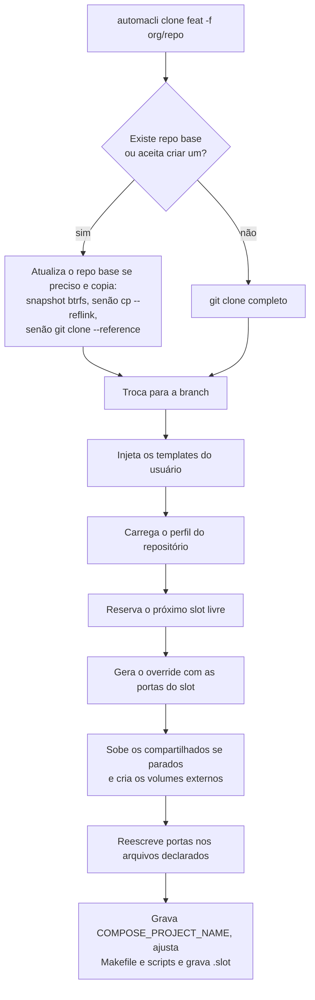

# Como funciona

## O problema

Uma stack de desenvolvimento publica portas fixas no host (`3000`, `5432`, `8080`). Duas cópias do mesmo repositório não sobem ao mesmo tempo: a segunda falha com "port is already allocated". Trocar de branch na mesma cópia obriga a parar tudo, reinstalar dependências e regenerar arquivos.

O automacli resolve isso dando a cada branch um diretório e um conjunto de portas próprios.

## Conceitos

| Termo | O que é |
|---|---|
| **Task** | Uma cópia do repositório em uma branch, em `<clonePath>/task-<branch>-<owner>-<repo>`. |
| **Repo base** | Uma task mantida atualizada na branch principal, com dependências instaladas. As outras tasks são copiadas dela. |
| **Slot** | Um número inteiro por task (1, 2, 3...). Define o deslocamento das portas e o nome do projeto compose. Fica no arquivo `.slot` da task. |
| **Perfil** | YAML que descreve o repositório: arquivos compose, serviços compartilhados, arquivos a reescrever. |
| **Serviço compartilhado** | Serviço com uma única instância para todas as tasks (banco, cache). Mantém a porta original. |
| **Override** | Arquivo compose gerado (`docker-compose.override.yml`) que aplica as portas do slot por cima do compose do repositório. |

## O que acontece em `automacli clone`



### 1. Cópia

Se já existe uma task do mesmo repositório, o automacli a copia. Com o repo base convertido em subvolume btrfs (`automacli base convert`), a cópia é um snapshot, instantâneo. Senão, é `cp --reflink=always` (`cp -c` no macOS): em Btrfs, XFS e APFS a cópia não ocupa espaço extra até os arquivos divergirem, mas percorre cada arquivo e leva cerca de um minuto em repos grandes. Nos dois casos `node_modules`/`vendor` vêm junto. Sem reflink, ele faz `git clone --reference` apontando para o repo base (histórico sem rede, mas as dependências precisam ser instaladas); sem repo base, `git clone` completo.

A origem preferida é uma task com `-base` no nome (o **repo base**). Se não houver nenhuma task do repositório, o automacli oferece criar `task-base-<owner>-<repo>`. Antes de copiar, ele verifica se o repo base está atrás da branch principal ou sem os artefatos declarados em [`baseRepo`](perfil.md#baserepo) e pergunta se deve atualizar.

### 2. Slot

O slot é o menor inteiro livre, olhando os arquivos `.slot` de todas as tasks em `clonePath`. O slot `0` é especial: mantém as portas e o nome de projeto originais.

### 3. Portas

Para cada porta publicada pela stack:

```text
porta no slot N = porta original + N × offset        (offset padrão: 100)
```

| Serviço | Original | Slot 1 | Slot 2 |
|---|---|---|---|
| `web` | 3000 | 3100 | 3200 |
| `api` | 4000 | 4100 | 4200 |
| `db` (compartilhado) | 5432 | 5432 | 5432 |

Com offset `100`, duas portas originais a uma distância múltipla de 100 colidem em slots diferentes: `8008` e `8808`
batem nos slots N e N+8, `7001` e `8001` nos slots N e N+10. Por isso o `clone` não pega simplesmente o próximo número
livre: ele pula qualquer slot cujas portas cairiam em cima das do slot 0 (repo base e stacks temporárias de scripts) ou
de um slot já alocado. Com `--slot` explícito ele só avisa.

As portas originais vêm de `docker compose config` (que resolve variáveis, `extends` e `include`), com leitura direta dos YAML como alternativa quando o Docker não está disponível. Você pode declarar ou corrigir portas em [`ports`](perfil.md#ports).

### 4. Override

O automacli nunca edita os arquivos compose do repositório. Ele gera um arquivo ao lado:

```yaml
# Auto-generated by automacli clone (slot 2)
services:
  api:
    ports: !override
      - '4200:80'
  db:
    profiles:
      - disabled
  web:
    ports: !override
      - '3200:80'

volumes:
  pgdata:
    external: true
    name: minha-api_pgdata
```

`!override` faz o Compose **substituir** a lista de portas em vez de somar (exige Docker Compose 2.24 ou mais novo; `automacli doctor` confere). O serviço compartilhado `db` sai da stack da task com `profiles: [disabled]`. O Compose carrega `docker-compose.override.yml` sozinho quando você não passa `-f`; se o seu projeto usa `-f` explícito (Makefile, scripts), liste esses arquivos em [`compose.wireInto`](perfil.md#compose) e o automacli acrescenta o override aos comandos.

### 5. Serviços compartilhados

Serviços listados em `shared.services` rodam uma vez só, **a partir do repo base**, no projeto compose do slot 0 (`<projectName>`). Eles não pertencem a nenhuma task: parar, remover ou recriar uma branch nunca derruba o banco das outras.

* Nas tasks, esses serviços entram no override como `profiles: [disabled]`, e cada stack só sobe o que é dela.
* Um serviço da task que tenha `depends_on` para um compartilhado perde essa dependência no override (`depends_on: !override` com o que sobrar), senão o Compose recusa o projeto por depender de um serviço desligado.
* Eles mantêm a porta original, e as tasks os acessam pela porta original no host (por exemplo, por uma variável como `HOST_IP` no `.env` do repositório).
* Os volumes de `shared.volumes` são os do projeto do slot 0 (`<projectName>_<volume>`): mesmos dados para todas as tasks.
* O `clone` e o `automacli override` sobem a stack compartilhada quando nenhum desses serviços está no ar; se algum ainda roda dentro de uma task, eles não mexem (migre com `automacli shared up`). Sem repo base, só avisam. `automacli shared status|up|down` mostra, inicia (migrando o que estiver rodando dentro de uma task) e para.
* Um `docker-compose.shared.yml` gerado no repo base dá `restart: unless-stopped` a esses serviços, então o Docker os traz de volta depois de reiniciar a máquina. Com `shared.autostart` (padrão) o [monitor](monitor.md#servicos-compartilhados-sempre-no-ar) cobre o resto: sobe a stack no boot mesmo que ela tenha sido parada, levanta o que cair e recria as filas por slot, que somem quando o ElasticMQ reinicia. `automacli shared down` segura até o próximo boot ou `shared up`.

O comportamento antigo, em que a primeira task a subir hospedava os compartilhados, continua disponível com `shared.host: first-task` no perfil.

Um serviço de **filas** (ElasticMQ) pode ser compartilhado do mesmo jeito, com um detalhe a mais: as tasks não podem
disputar as mesmas filas. Com `queues.service` em `shared.services`, o `clone` e o `automacli override` criam no
ElasticMQ as filas do `queues.conf` com um sufixo por slot (`gerar-pagamento-slot4.fifo`), a remoção da task as
apaga, e o placeholder `{{queueSuffix}}` dos templates diz às aplicações qual sufixo usar. O passo a passo está em
[Exemplos: um ElasticMQ para todas as tasks](exemplos.md#um-elasticmq-para-todas-as-tasks-filas-por-slot).

### 6. Reescrita de portas em arquivos

O override só muda o lado Docker. URLs e portas escritas em `.env`, `package.json` ou arquivos gerados continuariam apontando para o slot 0. As regras de [`rewrite`](perfil.md#rewrite) dizem quais arquivos atualizar e como. Só as portas de serviços **não** compartilhados são trocadas.

### 7. Nome do projeto compose

Cada slot é um projeto compose separado: `<projectName>-slot<N>`. O automacli grava `COMPOSE_PROJECT_NAME=<projeto>` no `.env` da task (a não ser que o perfil tenha `compose.projectNameEnv: false`), e o Compose passa a usar esse nome sem precisar de `-p`.

## Arquivos gerados em uma task

| Arquivo | Conteúdo |
|---|---|
| `.slot` | Slot, branch, projeto compose, owner/repo. |
| `docker-compose.override.yml` | Portas, serviços desabilitados, volumes compartilhados. |
| `docker-compose.limits.yml` | Ao lado de cada compose de teste, só com [isolamento](isolamento.md) ligado. |
| `.env` | Recebe `COMPOSE_PROJECT_NAME`; criado se não existir, e só nesse caso entra no exclude. |
| `docker-compose.shared.yml` | No repo base, não na task: `restart: unless-stopped` dos serviços compartilhados. |

Todos entram em `.git/info/exclude` da task, junto com os padrões de `gitExclude` do perfil. Nada disso aparece no `git status` nem altera o `.gitignore` do repositório.

## Onde o perfil é procurado

1. `~/.config/automacli/repos/<owner>-<repo>.yml` (do usuário)
2. `.automacli.yml` (ou `.automacli.yaml`) na raiz do repositório (versionado)
3. Nenhum arquivo: padrões e descoberta automática

O primeiro encontrado é usado por inteiro; os arquivos não são mesclados. O perfil do usuário vence para que cada pessoa possa ajustar o seu sem alterar o repositório.

O repositório de um diretório é identificado, nesta ordem, pelo `.slot`, pelo remoto `origin` e pelo nome `task-<branch>-<owner>-<repo>`.
