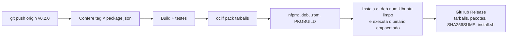

# Releases e CI/CD

O automacli é distribuído como um **executável Linux autocontido** e como pacotes `.deb`, `.rpm` e `PKGBUILD`, publicados nos [GitHub Releases do repositório `automacli-releases`](https://github.com/Gustavo210/automacli-releases/releases), que é público e também hospeda esta documentação. O código continua no repositório `automacli`, privado. Ele não está no npm.

O executável é um tarball com a CLI compilada, as dependências e o próprio Node.js. Quem instala não precisa ter Node na máquina.

## Instalar a partir de um release

```sh
curl -fsSL https://github.com/Gustavo210/automacli-releases/releases/latest/download/install.sh | bash
```

O instalador detecta a arquitetura (x64 ou arm64), confere o SHA-256, extrai em `~/.local/share/automacli` e cria o link `~/.local/bin/automacli`. Rodar de novo atualiza para a última versão.

| Quero... | Como |
|---|---|
| Uma versão específica | `bash install.sh v0.2.0` |
| Outro diretório | `AUTOMACLI_HOME=/opt/automacli AUTOMACLI_BIN=/usr/local/bin bash install.sh` |
| Instalar de outro repositório de releases | `AUTOMACLI_REPO=usuario/automacli-releases bash install.sh` |
| Desinstalar | `rm -rf ~/.local/share/automacli ~/.local/bin/automacli` |

O repositório de distribuição é público, então o `curl` acima funciona sem autenticação. Se um dia ele passar a ser privado, use o GitHub CLI autenticado, que o instalador detecta sozinho:

```sh
gh release download --repo Gustavo210/automacli-releases --pattern install.sh --output - | bash
```

### Pacotes e repositórios para distribuições

Cada release traz pacotes prontos e atualiza dois repositórios servidos pelo GitHub Pages do `automacli-releases`:

| Distribuição | Como instalar |
|---|---|
| Debian, Ubuntu e derivados | Repositório apt em `https://gustavo210.github.io/automacli-releases/apt` (suite `stable`, componente `main`, `amd64` e `arm64`), com `automacli.sources` e a chave `automacli.gpg` prontos |
| Fedora, RHEL, openSUSE | Repositório rpm em `https://gustavo210.github.io/automacli-releases/rpm/<arch>`, com `automacli.repo` e `RPM-GPG-KEY-automacli`; RPMs e `repomd.xml` assinados |
| Arch, Manjaro | Pacote `automacli-bin` no AUR, enviado pelo release quando a chave SSH da conta está configurada |

Os comandos prontos estão em [Instalação › Pela sua distribuição](instalacao.md#pela-sua-distribuicao). Os
repositórios guardam as três últimas versões de cada pacote; cada release também anexa os pacotes avulsos, com nome
estável (`automacli_amd64.deb`, `automacli.x86_64.rpm`) e com versão (`automacli_0.2.0_amd64.deb`,
`automacli-0.2.0-1.x86_64.rpm`), o `PKGBUILD`, o `.SRCINFO` e a chave pública.

Os pacotes instalam em `/opt/automacli` com o comando em `/usr/bin/automacli`, declaram `git` como dependência e Docker
como recomendação. Têm o mesmo conteúdo do tarball; a diferença é que o gerenciador de pacotes cuida de atualizar e
remover.

### Instalação manual

```sh
tar -xzf automacli-linux-x64.tar.gz -C ~/.local/share
ln -s ~/.local/share/automacli/bin/automacli ~/.local/bin/automacli
```

## Para quem mantém o projeto

As seções abaixo descrevem como as releases são produzidas. Elas valem para quem tem acesso ao repositório do código, que é privado; quem só instala o automacli não precisa delas.

## Pipelines

Os três ficam em `.github/workflows/`.

| Workflow | Dispara em | O que faz |
|---|---|---|
| `ci.yml` | push na `main` e pull requests | Instala as dependências, compila e roda os testes. |
| `release.yml` | push de uma tag `v*` ou manual, informando a tag | Compila, testa, empacota para `linux-x64` e `linux-arm64`, gera `.deb`, `.rpm` (assinado) e `PKGBUILD`, instala o `.deb` num Ubuntu e o `.rpm` num Fedora limpos, publica o release, atualiza os repositórios apt e rpm na `gh-pages` do `automacli-releases`, testa a instalação por eles e, com a chave do AUR, envia o `PKGBUILD`. |
| `docs.yml` | push na `main` que toque `docs/**`, ou manual | Compila o site VitePress de `docs/` e publica na branch `gh-pages` do `automacli-releases`, com o mesmo `RELEASES_TOKEN`. |



Cada release contém:

| Arquivo | Conteúdo |
|---|---|
| `automacli-linux-x64.tar.gz` | Executável para Intel/AMD de 64 bits. |
| `automacli-linux-arm64.tar.gz` | Executável para ARM de 64 bits. |
| `SHA256SUMS` | Checksums dos tarballs, dos pacotes e do `PKGBUILD`. |
| `install.sh` | Instalador. |
| `automacli_{amd64,arm64}.deb` e `automacli_<versão>_{amd64,arm64}.deb` | Pacote Debian/Ubuntu, com nome estável e com versão. |
| `automacli.{x86_64,aarch64}.rpm` e `automacli-<versão>-1.{x86_64,aarch64}.rpm` | Pacote Fedora/RHEL/openSUSE, com nome estável e com versão. |
| `PKGBUILD`, `.SRCINFO` | Pacote `automacli-bin` para o AUR. |

Os nomes não levam versão, para que `releases/latest/download/<arquivo>` aponte sempre para o mais recente.

## Publicar uma versão

```sh
npm version 0.2.0 --no-git-tag-version     # atualiza o package.json
git commit -am "chore: versão 0.2.0"
git tag v0.2.0
git push origin main v0.2.0
```

O workflow roda no repositório `automacli` (build, testes e empacotamento) e publica o release no `automacli-releases`, criando lá a tag de mesmo nome. As notas são geradas a partir dos commits do `automacli` e terminam com o link para o código-fonte da tag.

Além do token, o environment `RELEASES_TOKEN` guarda `PACKAGES_GPG_PRIVATE_KEY`, a chave GPG (armored, sem senha) que
assina os RPMs e os índices dos repositórios apt e rpm; sem ela o release falha com erro explícito. Opcionalmente,
`AUR_SSH_PRIVATE_KEY` (e `AUR_USERNAME`, `AUR_EMAIL`), a chave SSH de uma conta no AUR com o pacote `automacli-bin`:
com ela o release envia o `PKGBUILD` e o `.SRCINFO` ao AUR; sem ela, esse passo é pulado e o envio é manual. Os
repositórios apt e rpm vivem em `/apt` e `/rpm` da branch `gh-pages`, ao lado do site; o `docs.yml` os preserva ao
republicar a documentação, e os dois workflows compartilham o grupo de concorrência `gh-pages` para não se atropelarem.

Para isso o workflow usa o secret `RELEASES_TOKEN`: um fine-grained PAT com `Contents: Read and write` no `automacli-releases`, guardado no **environment** `RELEASES_TOKEN` do `automacli` (o job declara `environment: RELEASES_TOKEN`; sem isso o secret chega vazio e o passo de publicação falha com erro explícito). O `automacli-releases` precisa ter ao menos um commit, porque um release não pode ser criado em repositório vazio.

O workflow recusa a tag se ela não bater com a versão do `package.json`. Para republicar uma tag existente (por exemplo, depois de corrigir o workflow), use **Actions → Release → Run workflow** e informe a tag; os arquivos e as notas do release são substituídos.

## Gerar o executável e os pacotes localmente

```sh
pnpm build
pnpm exec oclif pack tarballs --targets linux-x64,linux-arm64 --no-xz
mkdir -p release && for a in x64 arm64; do mv dist/automacli-v*-linux-$a.tar.gz release/automacli-linux-$a.tar.gz; done
packaging/build-packages.sh 0.1.0 release     # precisa do nfpm (https://nfpm.goreleaser.com)
```

## Por que um tarball e não um arquivo único

A CLI usa oclif, que descobre os comandos lendo o diretório `dist/commands` em tempo de execução, e é escrita em ES Modules. As ferramentas que produzem um único arquivo executável (Node SEA, `bun build --compile`) exigem todo o código em um bundle estático, o que não combina com essa descoberta dinâmica. O tarball com o Node embutido é o formato suportado pelo próprio oclif e entrega o mesmo resultado prático: baixar, extrair e executar, sem instalar nada antes.
